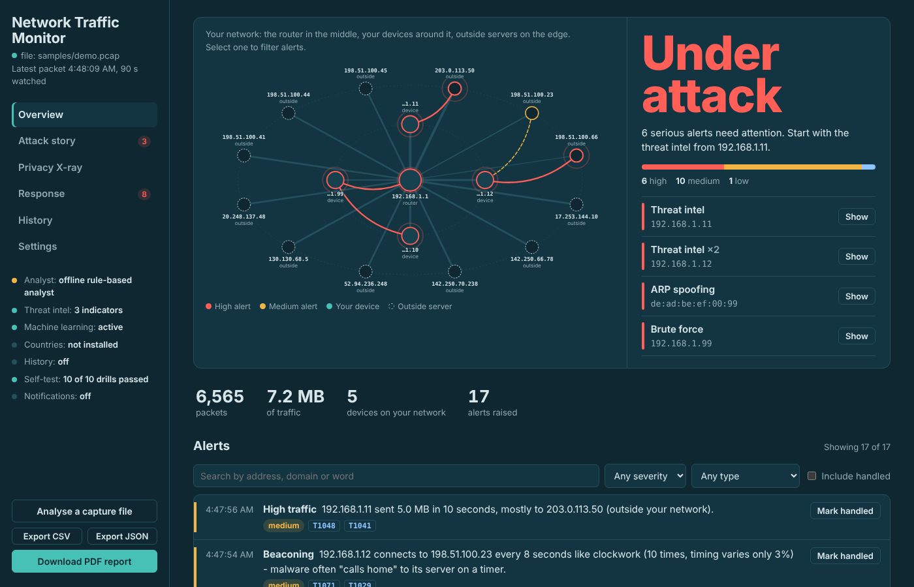
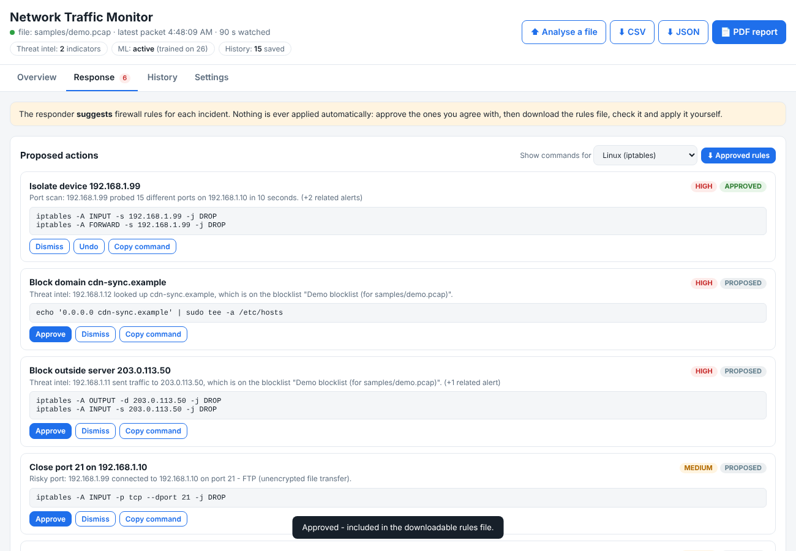
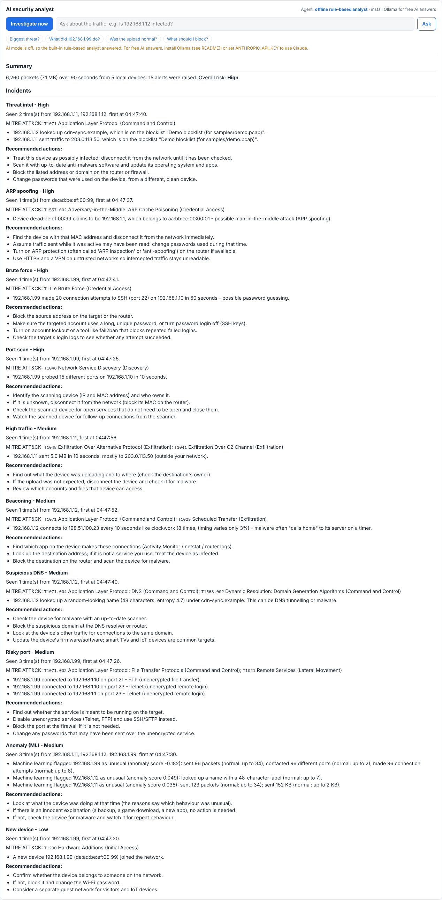

# Network Traffic Monitor

[](https://github.com/Nikhil11283031/network-traffic-monitor/actions/workflows/tests.yml)


A Python network intrusion-detection tool. It watches network traffic, detects suspicious activity with
rules, **threat-intelligence blocklists** and **machine learning**, tags every finding with its **MITRE ATT&CK**
technique, and shows it all on a live web dashboard with an **AI security analyst**. It can capture live traffic
from your own computer or analyse a saved `.pcap` capture file (for example one recorded with Wireshark).

**Highlights**

- Nine rule-based detectors: port scan, SYN flood, brute-force logins, ARP spoofing (man-in-the-middle),
  malware beaconing, risky ports, data exfiltration, DNS tunnelling and new devices
- Threat intelligence from free public blocklists (abuse.ch Feodo Tracker, Spamhaus DROP, URLhaus domains)
- GeoIP: the country of every outside server, with alerts for countries you choose to watch
- Unsupervised ML anomaly detection (Isolation Forest) that learns your network's normal behaviour
- MITRE ATT&CK technique on every alert, linked to the official description
- AI analyst agent (Claude, or free and local with Ollama) with a verification safety check
- Responder that proposes firewall rules (macOS pf, Linux iptables, Windows, router) for a person to approve
- Dashboard controls: live settings, search and filters, mark alerts as handled, upload a capture, export
  CSV/JSON, PDF incident report
- Alert history in SQLite, notifications to macOS, Discord, Slack, email or any webhook
- MCP server, so Claude Desktop and other AI apps can query the monitor
- Accuracy benchmark against public datasets (CIC-IDS2017, UNSW-NB15) with detection rate, time to detect,
  precision and false alarms per hour
- 66 automated tests, GitHub Actions CI and a Docker image



## What it detects

| Alert | Severity | How it is detected |
| --- | --- | --- |
| **Port scan** | High | One host tries 15+ different ports on another host within 10 seconds (counts connection attempts only, so normal replies are ignored). |
| **SYN flood** | High | 200+ connection attempts to one host within 5 seconds - a sign of a denial-of-service attack. |
| **Risky port** | Medium | A connection to a service that is unsafe or often abused: FTP (21), Telnet (23), SMB (445), MS SQL (1433), RDP (3389), 4444 (common backdoor), VNC (5900), IRC (6667). |
| **High traffic** | Medium | One host sends 5 MB+ within 10 seconds - a large upload could be data being stolen. |
| **Suspicious DNS** | Medium | A DNS lookup with a very long (40+ characters) or random-looking name, measured with Shannon entropy. Malware uses this to hide data in DNS (DNS tunnelling) or to find its servers. |
| **New device** | Low | A device that was not on the local network during the first 30 seconds appears. |
| **Threat intel** | High | A device talks to, or looks up, an IP address or domain on a threat-intelligence blocklist. |
| **ARP spoofing** | High | A device claims an IP address (usually the router's) that already belongs to another device's MAC address - the classic way to put yourself in the middle of other people's traffic. |
| **Brute force** | High | 20+ connection attempts to one login service (SSH, RDP, FTP, Telnet, SMB, VNC, databases) within 60 seconds - password guessing. |
| **Beaconing** | Medium | A device connects to the same outside server 10+ times at regular intervals (gaps vary by 15% or less) - how malware "calls home" to its command server. Ten, not eight, because the benchmark showed random traffic occasionally looks regular for eight connections. |
| **Watched country** | Medium | A device talks to a server in a country on your watch list (needs the GeoIP database). |
| **Anomaly (ML)** | Medium | The machine-learning model finds a device behaving unlike anything it learned as normal. |

Repeated alerts for the same thing are grouped (one alert per minute; beaconing once per 30 minutes), so the
list stays readable. Every limit can be changed live on the dashboard's **Settings** tab (or in `Config` in
`netmon/analyzer.py`).

The dashboard also shows packets per second, protocols, the hosts sending and receiving the most data, the
ports being contacted (risky ones in red), DNS lookups by domain, and every device seen on the local network.

## MITRE ATT&CK mapping

[MITRE ATT&CK](https://attack.mitre.org) is the security industry's shared catalogue of attacker techniques.
Every alert is tagged with the matching technique, shown as a link on the dashboard and given to the AI analyst
(`netmon/mitre.py`):

| Alert | Technique | Tactic |
| --- | --- | --- |
| Port scan | T1046 Network Service Discovery | Discovery |
| SYN flood | T1498.001 Direct Network Flood | Impact |
| Risky port | T1021 Remote Services (RDP T1021.001, SMB T1021.002, VNC T1021.005), T1071.002 File Transfer Protocols, T1571 Non-Standard Port | Lateral Movement / Command and Control |
| High traffic | T1048 Exfiltration Over Alternative Protocol, T1041 Exfiltration Over C2 Channel | Exfiltration |
| Suspicious DNS | T1071.004 DNS, T1568.002 Domain Generation Algorithms | Command and Control |
| New device | T1200 Hardware Additions | Initial Access |
| Threat intel | T1071 Application Layer Protocol | Command and Control |
| ARP spoofing | T1557.002 Adversary-in-the-Middle: ARP Cache Poisoning | Credential Access |
| Brute force | T1110 Brute Force | Credential Access |
| Beaconing | T1071 Application Layer Protocol, T1029 Scheduled Transfer | Command and Control / Exfiltration |

The mapping is the best match for what can be seen in traffic, not proof that the technique was used.

## Threat intelligence

Security researchers publish free lists of servers known to run malware, botnets or criminal networks. Traffic
to any of them is a strong warning sign, so it raises a **high** alert (`netmon/threatintel.py`).

```bash
python3 -m netmon update-intel      # downloads the free feeds into intel/
```

| Feed | What it lists |
| --- | --- |
| abuse.ch **Feodo Tracker** | Botnet command-and-control server IPs |
| **Spamhaus DROP** | Hijacked and criminal IP ranges |
| **URLhaus** (abuse.ch data, via the malware-filter project) | Domains spreading malware |

Lists are plain text files in `intel/` (IP addresses, CIDR ranges, domains, hosts-file lines or Spamhaus JSON
lines), so you can add your own. `intel/demo.txt` lists the documentation-only addresses used by the demo
capture. Re-run `update-intel` regularly; the lists change daily. Use `--intel DIR` or `--no-intel` to change
or turn off the check.

## GeoIP (country of each connection)

```bash
python3 -m netmon update-geoip                       # free DB-IP country database (about 5 MB)
python3 -m netmon pcap capture.pcap --watch-countries KP,IR
```

The **Top talkers** table then shows each outside server's country, and traffic to a country on your watch
list raises an alert. Countries can also be changed on the Settings tab. IP geolocation by
[DB-IP](https://db-ip.com), licensed under CC BY 4.0.

## Machine-learning anomaly detection

Rules only catch what someone thought of in advance. The ML detector **learns what normal looks like** on
your network and flags behaviour that does not fit (`netmon/ml.py`):

1. Traffic is cut into 5-second windows. For each active local device a feature vector is built: packets and
   kilobytes sent, number of different hosts and ports contacted, connection attempts, DNS lookups, and the
   longest and most random DNS name.
2. **Learning phase:** the first 40 seconds of a capture file (5 minutes for live traffic, `--ml-learn` to
   change) are treated as normal.
3. An **Isolation Forest** (scikit-learn) is trained on those windows. It isolates unusual points with few
   random splits, giving them a low anomaly score. It is **unsupervised**: no labelled attack data is needed.
4. Each later window is scored. An alert needs a low score **and** at least one feature at least double the
   highest normal value, so every alert says why: *"contacted 96 different ports (normal: up to 2)"*. This
   second check keeps false alarms down, which matters because the model learns from little data.

On the demo capture it flags the intruder, the phone's upload and the TV's DNS leak, and never the normal
laptop. The dashboard shows whether it is still learning or active. Turn it off with `--no-ml`.

## Dashboard

The dashboard has four tabs:

- **Overview** - live counters, chart, protocols, the alert list with **search, severity and type filters**
  and a **Handled** button (with an optional note) to mark alerts you have dealt with, the AI analyst, top
  talkers with country, ports, DNS lookups and devices.
- **Response** - the responder's proposed actions (see below) to approve or dismiss.
- **History** - every alert saved in the database across all runs, searchable, with "only not handled".
- **Settings** - change any detection limit live, see the status of each component, send a test notification.

The toolbar can **analyse a capture file** you pick (it becomes a new session), **export** the alerts as CSV or
JSON, and download a **PDF incident report** containing the analyst's findings, every alert with its MITRE
technique, the proposed responses and the devices seen.

## Responder: firewall rules you approve



For each incident the responder proposes one concrete action - **isolate** a device on your network, **block** an
outside server or domain, or **close** a risky port - with the exact command for **macOS (pf)**, **Linux
(iptables)**, **Windows (PowerShell)** and plain **router** instructions. Approve the ones you agree with and
download them as one rules file to check and apply.

Nothing is ever applied automatically, on purpose: an attacker can deliberately trigger alerts to make an
automatic tool block your own router, and a false positive could cut off a family member's laptop. The AI
analyst can read the proposals (`get_proposed_responses`) and explain which to approve first.

## History and notifications

Alerts are saved to `netmon.db` (SQLite) as they happen, so they survive restarts. Browse them on the History tab
or in the terminal:

```bash
python3 -m netmon history --severity high --open      # high alerts not yet marked as handled
```

Get told about serious alerts without watching the dashboard:

```bash
python3 -m netmon pcap capture.pcap --notify-mac                        # macOS notification
sudo .venv/bin/python -m netmon live --discord-webhook https://discord.com/api/webhooks/...
python3 -m netmon pcap capture.pcap --slack-webhook https://hooks.slack.com/services/...
python3 -m netmon pcap capture.pcap --webhook https://example.com/hook --notify-min medium
NETMON_SMTP_HOST=smtp.gmail.com NETMON_SMTP_USER=you@gmail.com NETMON_SMTP_PASSWORD=app-password \
  python3 -m netmon pcap capture.pcap --email-to you@gmail.com
```

Only alerts at or above `--notify-min` (default high) are sent, at most once per alert type and device every 5
minutes and no more than 10 a minute, so an attack cannot flood your phone.

## MCP server (use the monitor from Claude Desktop)

The [Model Context Protocol](https://modelcontextprotocol.io) lets AI apps use outside tools. While the dashboard
is running, `python3 -m netmon mcp` gives any MCP client the analyst's read-only tools. For Claude Desktop, add
this to `claude_desktop_config.json` (Settings > Developer > Edit Config), using your own paths:

```json
{
  "mcpServers": {
    "network-monitor": {
      "command": "/Users/you/network-traffic-monitor/.venv/bin/python",
      "args": ["-m", "netmon", "mcp"],
      "cwd": "/Users/you/network-traffic-monitor"
    }
  }
}
```

Then ask Claude things like *"Use the network monitor: what is the most serious alert and what should I do?"*.

## Security of the dashboard itself

- It listens on `127.0.0.1` only, so other devices cannot open it.
- Requests addressed to any other host name are refused, which blocks DNS-rebinding attacks from websites.
- Every request that changes something must carry an `X-Netmon` header, which other websites cannot add, so a page
  you visit cannot approve responses, change settings or upload files behind your back (CSRF).
- CSV exports neutralise spreadsheet formulas, because alert text (domain names) comes from the network.
- Uploaded files are saved under a fixed name in a temporary folder, never under the name the browser sent.

## AI security analyst agent

The dashboard has an **AI security analyst**: an agent that investigates the traffic by itself and writes an
incident report, or answers questions such as *"Is 192.168.1.12 infected?"*. It runs on Claude (Anthropic API)
or, for free, on a local open model through Ollama.



It works as a **tool-using agent loop** (`netmon/agent.py`):

1. The agent receives the request and a list of tools it may call.
2. Claude decides which tool it needs and the program runs it, for example `get_overview`, then
   `get_host_activity("192.168.1.99")`, then `get_response_playbook("Port scan")`.
3. The result goes back to Claude, which decides on the next step. This repeats (up to 6 rounds) until it has
   enough evidence.
4. It writes a report: summary and risk level, one section per incident with evidence, the likely explanation
   (including innocent ones) and recommended actions. The dashboard shows each tool call it made.

| Tool | What it returns |
| --- | --- |
| `get_overview` | Totals, protocols, top talkers, ports, DNS domains, devices, alert counts |
| `list_alerts` | Alerts, filtered by severity or type |
| `get_host_activity` | One IP: data sent/received, who it talked to, ports, DNS lookups, MAC, its alerts |
| `get_dns_lookups` | DNS names looked up by a host, or the top domains |
| `lookup_port` | The service on a port and whether it is risky |
| `get_response_playbook` | Standard response steps for an alert type |

**Safety design**

- **Read-only tools.** The agent can look but cannot block traffic or change anything, so a wrong answer
  cannot cause harm. A person decides what to do.
- **Prompt-injection defence.** Packet contents (DNS names especially) are controlled by whoever sends the
  packets. An attacker could look up a name like `ignore-previous-instructions...`. The system prompt tells the
  model to treat all tool output as untrusted data, and long strings are cut to 120 characters.
- **Fallback.** Without an AI backend, or if it cannot be reached, a built-in **offline rule-based analyst**
  writes the report from the alerts and playbooks, so the tool always works.

**Choosing the AI** - the analyst picks the first one available:

| Backend | Cost | How to turn it on |
| --- | --- | --- |
| **Ollama** (local open model, e.g. Qwen 2.5) | Free | Install Ollama and download a model (below). Your traffic data never leaves your computer. |
| **Claude** (Anthropic API) | Paid, a few cents per investigation | `export ANTHROPIC_API_KEY=sk-ant-...` (optional `NETMON_MODEL`) |
| **Offline analyst** (rules) | Free | Always available. Answers "biggest threat", uploads, DNS, scans and single-IP questions. |

Force one with `NETMON_PROVIDER=ollama`, `claude` or `offline`.

**Free AI with Ollama (Mac, Windows or Linux)**

1. Download and install Ollama from <https://ollama.com/download>, then open it.
2. Download a model that supports tool calling (one time, a few GB):
   ```bash
   ollama pull qwen2.5:7b        # best choice, needs about 8 GB of RAM
   ollama pull llama3.2:3b       # smaller and faster for 8 GB machines
   ```
3. Start the monitor as usual. The dashboard should say **Agent: Ollama - qwen2.5:7b (free, runs on this computer)**.
   Pick a specific model with `export NETMON_OLLAMA_MODEL=llama3.2:3b`.

Local models are slower than Claude (expect 20 to 90 seconds per investigation on a laptop) and smaller ones
sometimes call the wrong tool, but the agent loop is the same.

Console only: `python3 -m netmon pcap samples/demo.pcap --no-web --investigate`.

## Setup

Needs Python 3.10 or newer.

```bash
python3 -m venv .venv
source .venv/bin/activate          # Windows: .venv\Scripts\activate
pip install -r requirements.txt
```

## Running it

**1. Demo with the sample capture (no admin rights needed)**

```bash
python3 make_sample_pcap.py                         # creates samples/demo.pcap
python3 -m netmon pcap samples/demo.pcap --speed 5  # replays it 5x faster
```

Open <http://127.0.0.1:5050>. Over about 20 seconds you will see normal traffic, then an unknown device join
the network, port-scan a laptop, try Telnet on the router, pretend to be the router (ARP spoofing) and guess the
laptop's SSH password, a smart TV "call home" every 8 seconds and leak data through DNS, and a phone upload 6 MB
to an outside server. Each one appears as an alert.

**2. Watch your own network live**

Capturing packets needs administrator rights:

```bash
sudo .venv/bin/python -m netmon live                 # default interface
sudo .venv/bin/python -m netmon live --iface en0     # en0 is usually Wi-Fi on a Mac
sudo .venv/bin/python -m netmon live --filter "tcp or udp port 53"
```

To try the detection safely on your own machine, scan your own computer from another terminal, e.g.
`nmap -p 1-100 127.0.0.1` with `--iface lo0` (Mac) or `--iface lo` (Linux).

**3. Analyse a Wireshark capture**

```bash
python3 -m netmon pcap mycapture.pcap                # instant analysis + dashboard
python3 -m netmon pcap mycapture.pcap --no-web --report report.json   # console only, save a JSON report
```

Other options: `--port 5051`, `--no-web` (console only), `--no-intel`, `--no-ml`, `--ml-learn SECONDS`,
`--db FILE` / `--no-db`, `--pdf report.pdf` (write a PDF report at the end), `--watch-countries KP,IR`.
Run `python3 -m netmon pcap --help` for the full list.

**4. With Docker**

```bash
docker compose up            # builds the image and replays the demo; open http://127.0.0.1:5050
```

The container uses Ollama on your computer for the AI analyst if it is running, and reads threat-intelligence
lists from the `intel/` folder. Docker is intended for the demo and for capture files: on macOS and Windows,
Docker runs inside a virtual machine, so live capture in a container only sees the VM's traffic.

## How it works

```
 network interface ──► scapy sniff()  ─┐
                                       ├─► to_packet_info() ─► Analyzer.process() ─► alerts + statistics
 .pcap file ────────► scapy PcapReader ┘          (capture.py)        (analyzer.py)          │
                                                                                             ▼
                                                     browser ◄── /api/snapshot (JSON) ◄── Flask (web.py)
                                                        │                                    ▲
                                                        └─► /api/agent ─► AI analyst ─► tools ┘ (read-only)
                                                                         (agent.py) ◄─► Claude API or Ollama (local)
```

- `netmon/capture.py` reads packets with **scapy** and turns each one into a small `PacketInfo` record
  (time, addresses, protocol, ports, TCP flags, DNS name, MAC address).
- `netmon/analyzer.py` keeps running statistics and applies the detection rules using **sliding time windows**
  based on each packet's own timestamp, so a saved capture gives exactly the same results as watching live.
- `netmon/web.py` serves the dashboard; the page asks for a fresh snapshot every two seconds.
- `netmon/mitre.py` maps alerts to MITRE ATT&CK; `netmon/threatintel.py` loads and matches blocklists;
  `netmon/geoip.py` looks up countries; `netmon/ml.py` is the Isolation Forest anomaly detector.
- `netmon/monitor.py` ties a session together; `netmon/store.py` is the SQLite history; `netmon/notify.py`
  sends notifications; `netmon/responder.py` proposes firewall rules; `netmon/report.py` builds the PDF;
  `netmon/mcp_server.py` is the MCP server.
- `netmon/agent.py` is the AI analyst; it reads the same analyser through read-only tools.
- Capture runs in a background thread; a lock keeps the statistics consistent while the dashboard reads them.

## Accuracy benchmark

Claims about detection mean nothing without numbers, so the monitor can score itself against public datasets of
real, labelled attacks:

```bash
python3 -m netmon benchmark Friday-WorkingHours.pcap --truth cicids2017-friday
```

It replays the whole capture, compares every alert with the answer key and writes a report (Markdown and JSON in
`benchmark-results/`) with:

- **Detection rate**: how many attacks raised at least one alert, and how many were caught by the detector built
  for that kind of attack.
- **Time to detect** for each attack.
- **Precision and false alarms per hour**, overall and for each detector, with examples of the false alarms.
- **Speed** in packets per second.

Attacks that can only be seen inside packet contents (SQL injection, cross-site scripting, Heartbleed, exploits)
are listed as out of scope instead of being hidden: this monitor looks at who talks to whom, how much and when,
not at the contents.

**Answer keys**

| `--truth` | Dataset |
| --- | --- |
| `cicids2017-monday` ... `cicids2017-friday` | [CIC-IDS2017](https://www.unb.ca/cic/datasets/ids-2017.html), built in from the official attack schedule (Monday has no attacks, so it measures false alarms on normal traffic) |
| `UNSW-NB15_GT.csv` | [UNSW-NB15](https://research.unsw.edu.au/projects/unsw-nb15-dataset) ground-truth file |
| `my-attacks.json` | Your own: `{"episodes": [{"name", "start", "end", "attackers": [...], "victims": [...], "expected": [...]}]}` |

**Running it on CIC-IDS2017**

1. Download the PCAPs from the dataset's download page (linked from the CIC page above). Each day is one large file
   (roughly 8 to 13 GB).
2. Run one day at a time, for example
   `python3 -m netmon benchmark Tuesday-WorkingHours.pcap --truth cicids2017-tuesday`.
   The fast reader (`dpkt`) processes about 20,000 to 30,000 packets per second on a laptop, so a day takes
   minutes rather than hours.
3. Read `benchmark-results/Tuesday-WorkingHours.md`. Change limits on the Settings tab (or in `Config`) and run it
   again to see the effect - but tune on one day and report the results of the others, so the numbers stay honest.

`samples/demo-truth.json` is the answer key for the demo capture; `python3 -m netmon benchmark samples/demo.pcap
--truth samples/demo-truth.json --ml-learn 40` checks the scoring itself (7 of 7 attacks, no false alarms).

## Tests and CI

```bash
python3 -m pytest
```

GitHub Actions (`.github/workflows/tests.yml`) runs the tests on Python 3.10, 3.11 and 3.12 on every push, runs
the demo, and builds and runs the Docker image. The badge at the top shows the result.

38 tests cover MITRE tagging, every threat-intelligence feed format and the feed download, the ML detector
(learning, flagging only unusual behaviour, the demo capture, running without scikit-learn), and each detection rule, false-positive checks (normal browsing, slow connections, replies, ordinary
long domain names), configurable thresholds, an end-to-end run over the sample capture, and the AI agent: the
tool-calling loop (with a scripted fake Claude client, so no API key is needed), the step limit, the offline
fallback, bad tool input, clipping of long attacker-controlled strings, and the web endpoints.

## Limitations and ideas

- Encrypted traffic (HTTPS) is not decrypted; the monitor looks at who talks to whom, how much and when.
- Rules are thresholds, so a slow scan spread over minutes is not caught. The ML detector helps, but it
  only knows what it saw while learning; if an attack is already happening then, it is learned as normal.
- Blocklists only know about servers that have already been reported.
- ARP spoofing detection can also fire when a device legitimately gets a new network card or address.
- Ideas: run at startup as a service, export alerts to a SIEM (Splunk, Elastic), TLS fingerprinting (JA3) to
  recognise malware inside encrypted traffic.

## Ethics

Only monitor networks you own or have written permission to monitor. Capturing other people's traffic without
permission is illegal in Australia and many other countries. The sample capture is fully simulated.
